<div align="center">

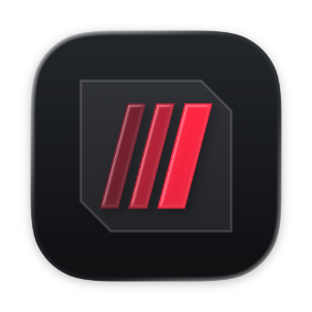

# ROG 控制中心 · macOS 中文版

**给 ASUS ROG Zephyrus G14（GA403WM）黑苹果用的 macOS 控制中心**

性能模式 · CPU 功耗上限 · 风扇曲线 · 电池充电上限 · 键盘背光 · Slash 灯效

[](https://github.com/GeekAudio/rog-control-macos/actions/workflows/build.yml)
[](https://github.com/GeekAudio/rog-control-macos/actions/workflows/release.yml)
[](LICENSE)

[下载](../../releases/latest) · [安装](#安装) · [从源码构建](#从源码构建) · [常见问题](#常见问题)

</div>

---

macOS 没有华硕 ACPI WMI 设备的驱动，所以嵌入式控制器会一直保持开机时的那套性能模式与功耗上限，macOS 上没有任何东西能改它。
本仓库就是 Linux `asus-wmi` / `asus-armoury`（对应内核扩展）和 [asusctl](https://github.com/opengamingcollective/asusctl) 的
`asusd` / `rog-control-center`（对应应用）在 macOS 上的对应实现。**没有包含任何 asusctl 代码**，详见 [NOTICE.md](NOTICE.md)。

> 本项目是 [thanhnndev/rog-control-macos](https://github.com/thanhnndev/rog-control-macos) 的**简体中文分支**。
> 界面文字、诊断日志、脚本提示与 README 均已汉化；构建与发布由 GitHub Actions 全自动完成。
> 上游原始英文 README 保留在 [README.en.md](README.en.md)，越南语版在 [README.vi.md](README.vi.md)。

> ⚠️ **这是运行在内核里的代码。** 安装任何东西之前请先读源码，并且始终保留一条不加载它们也能开机的退路
> （OpenCore 选择菜单，或从 `config.plist` 里移除对应的 kext）。

## 目录

- [包含什么](#包含什么)
- [状态与兼容性](#状态与兼容性)
- [截图](#截图)
- [安装](#安装)
- [汉化说明](#汉化说明)
- [从源码构建](#从源码构建)
- [安装内核扩展](#安装内核扩展)
- [文档](#文档)
- [常见问题](#常见问题)
- [分支](#分支)
- [许可证与致谢](#许可证与致谢)

## 包含什么

| 组件 | 位置 | 作用 |
|---|---|---|
| `AsusWmi.kext` | `kexts/AsusWmi` | 匹配 ACPI 的 `ATKD` 设备（`PNP0C14`，`_UID "ATK"`），像 `asus-wmi` 那样调用它的 WMI 方法：性能模式、PPT 功耗上限（按接电/电池分别校验范围）、风扇曲线、风扇转速、充电上限、键盘背光与 Aura（N-KEY HID 报告）、Slash 灯效，以及 rogkeyd 转发的 Fn 键（`kAsusUcKey`，ABI 5） |
| `AmdCppc.kext` | `kexts/AmdCppc` | 锐龙 AI 9 HX 370：Tctl 与封装功耗（`debug.amdcppc.sensors`）、每核频率（`debug.amdcppc.freq`）、CPPC 加速与 EPP 控制 |
| `RogControl.app` | `macos/RogControl` | SwiftUI 菜单栏应用 + 主窗口：模式、实时读数、电池、自定义功耗、灯效、声音、麦克风与摄像头，以及一个检查整套环境的「体检」。通过 user client 与 AsusWmi 通信，**不需要 sudo**，每个用户一份 |
| `rogkeyd.app` | `macos/RogKeys` | LaunchAgent，读取 macOS 会丢弃的 N-KEY Fn 键（厂商报告 0x5A）并交给 AsusWmi；麦克风静音、飞行模式、Fn+F9 与 M4 由它自己处理。需要「输入监控」权限（Fn+F9 还需要「辅助功能」） |
| `AmdCppcPolicy` | `macos/AmdCppcPolicy` | 以 root 运行的 LaunchDaemon，在开机与唤醒后应用 CPPC 策略 |

## 状态与兼容性

参考机型：**GA403WM，锐龙 AI 9 HX 370**。2026-10-12 由机主在 macOS 15（24H32）上逐项确认可用：性能模式
（静音 / 性能 / 增强）、手动功耗上限、风扇曲线、风扇转速、充电上限（60 / 80 / 100 %）、按供电方式分别保存的设置、
键盘背光、Slash 灯效、RogControl 应用本体。

- macOS 26（Tahoe）**尚未验证**。
- 其它华硕机型**未测试**；功耗上限的范围取自 GA403WM。
- 逐项功能细节与待办事项见 [docs/ASUSCTL-MACOS.md](docs/ASUSCTL-MACOS.md)（英文）。

## 截图

以下截图都是本汉化版用离屏渲染生成的真实界面（示例数据）。

<div align="center">
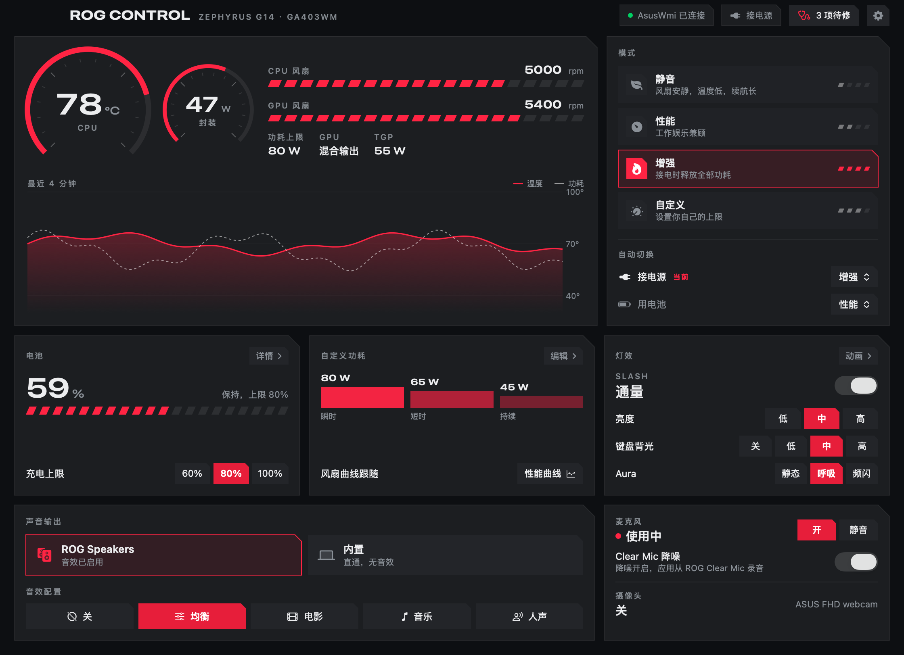
<br><em>一屏搞定：上方是实时读数与模式，下方是电池、自定义功耗与灯效。设置类操作以对话框弹出。</em>
</div>

<br>

<div align="center">
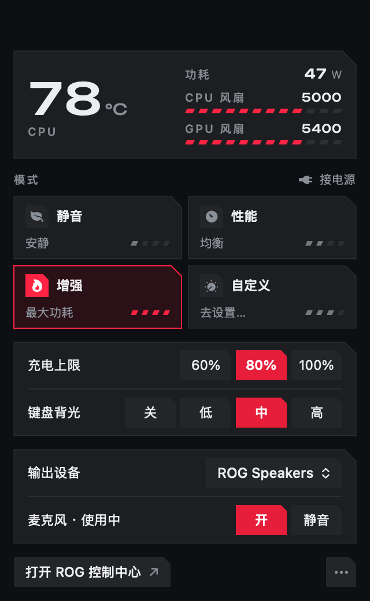
<br><em>菜单栏面板</em>
</div>

<br>

<div align="center">
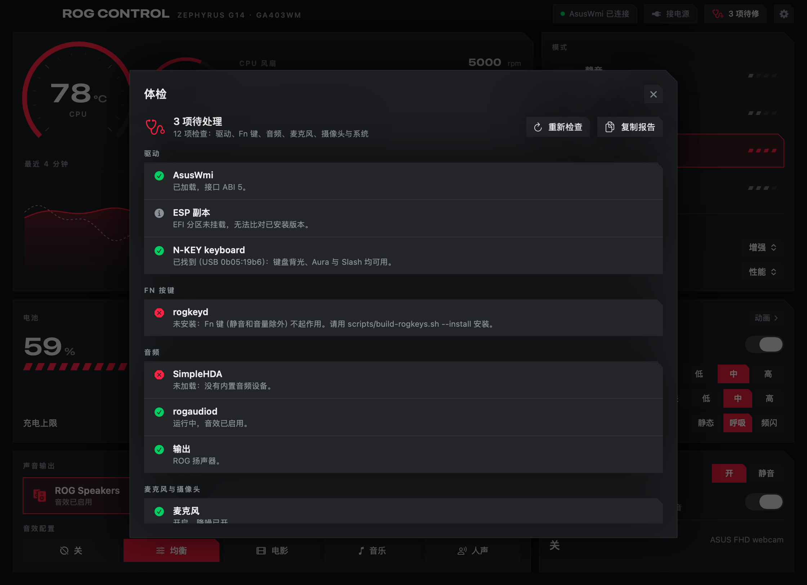
&nbsp;&nbsp;
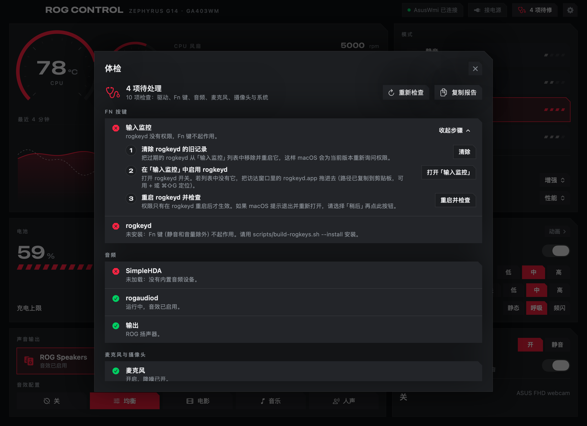
<br><em>「体检」：所有依赖列成一张表，缺权限时给出分步引导</em>
</div>

<br>

<div align="center">
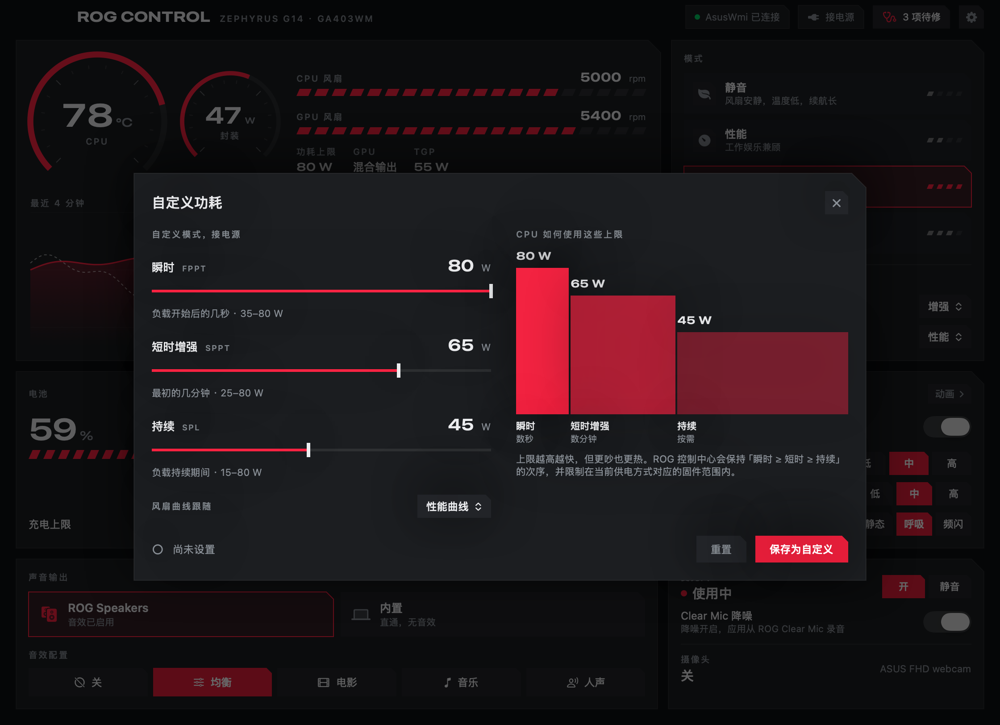
&nbsp;&nbsp;
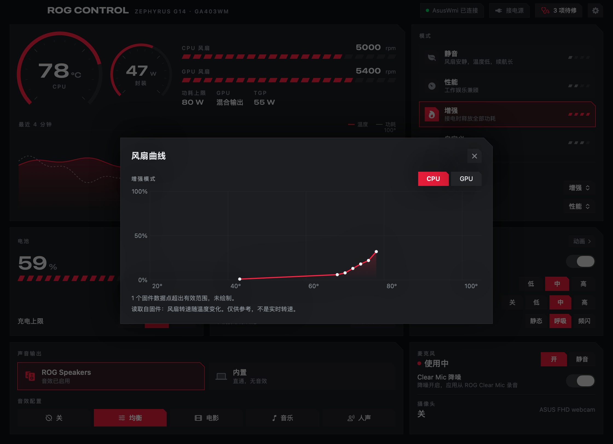
<br><em>自定义功耗（用大白话写清瞬时 / 短时 / 持续）与固件风扇曲线</em>
</div>

<br>

<div align="center">
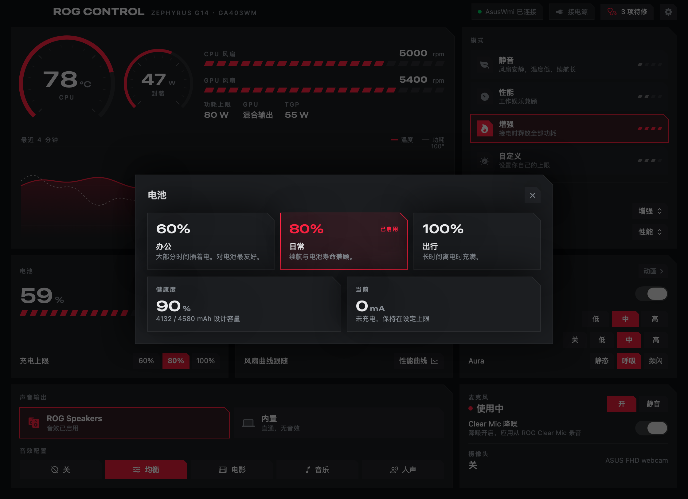
&nbsp;&nbsp;
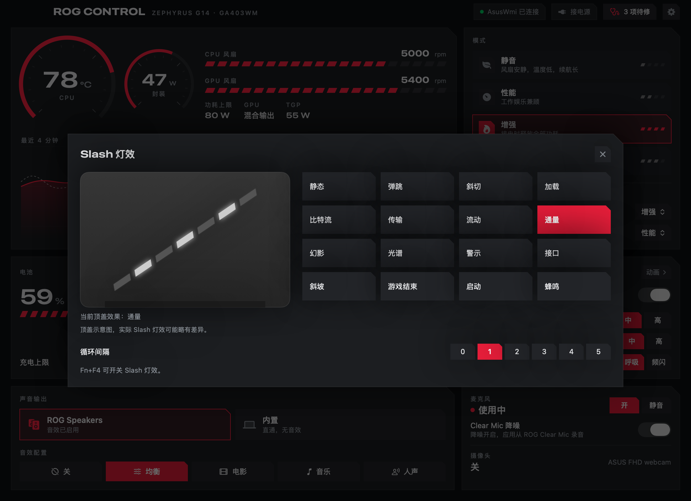
<br><em>电池（充电上限预设与健康度）与 Slash 动画（带 G14 顶盖预览）</em>
</div>

<br>

<div align="center">
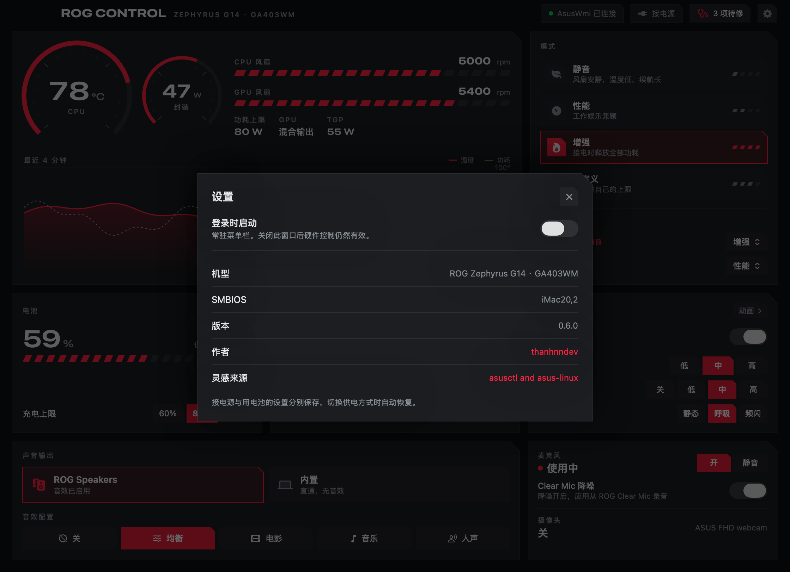
&nbsp;&nbsp;
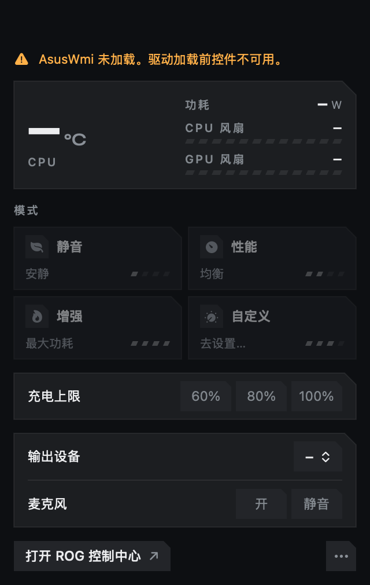
<br><em>设置；以及 AsusWmi 未加载时的面板——控件全部置灰，绝不瞎猜</em>
</div>

## 安装

### 1. 内核扩展（必需）

从 [最新发布](../../releases/latest) 下载 `AsusWmi.kext.zip` 与 `AmdCppc.kext.zip`：

1. 解压后把 `AsusWmi.kext`（以及 `AmdCppc.kext`）放进 `EFI/OC/Kexts`。
2. 用 OpenCore Configurator 或 ProperTree 在 `config.plist` 的 `Kernel › Add` 里各加一条，路径指向上面放的 kext。
3. 重启。

也可以用 `scripts/macos-install-kext.sh AsusWmi` 自动完成拷贝（旧版本会备份到 `EFI/OC/Kexts-backup`，`--undo` 可回滚），
但它**不会**替你改 `config.plist`。

### 2. 菜单栏应用

下载 `RogControl-x.y.z.dmg`，双击打开，把「ROG Control」拖进「应用程序」。

> **首次打开被系统拦截怎么办？**（本程序没有 Apple 开发者签名，属于正常现象）
>
> 双击后会提示「无法打开，因为 Apple 无法检查其是否包含恶意软件」：
> 1. 点「**完成**」（不要点「移到废纸篓」）；
> 2. 打开 **系统设置 › 隐私与安全性**，滚到「安全性」一栏；
> 3. 点「**仍要打开**」，输入密码；
> 4. 再回 Finder 双击一次，弹窗里点「**打开**」。
>
> macOS 15 起已取消「右键 → 打开」的绕过方式，上面这条路是唯一可行的。

### 3. Fn 功能键（可选）

解压 `rogkeyd.app.zip`，然后用：

```bash
bash scripts/build-rogkeys.sh --install
```

安装完成后打开 **系统设置 › 隐私与安全性 › 输入监控**，允许 rogkeyd。
装好后打开应用点右上角的「体检」，它会告诉你还差哪一步。

## 汉化说明

汉化覆盖：**全部界面文字**（菜单栏面板、主窗口、六个对话框、体检项与分步引导、错误提示、菜单栏菜单）、
**诊断日志**、**构建脚本输出**，以及本文档。

有一批字符串**必须保持英文**，因为它们不是给人看的，而是程序之间约定的值。这些地方特意没有动：

| 保持英文的内容 | 原因 |
|---|---|
| `silent` / `performance` / `turbo` / `manual` | `Mode` 枚举的 `rawValue`，是 `UserDefaults` 的键名（`ac.mode`、`battery.mode`），改了会丢用户设置 |
| `off` / `balanced` / `movie` / `music` / `voice` | 要写进 rogaudiod 的 `settings.plist`，由 rogaudiod 按值匹配；显示用的中文名是另外一份 |
| `Driver` / `Fn keys` / `Audio` / … | 体检的分组键，同时用作 `add()` 的分组参数与过滤条件。**显示**时经 `Doctor.groupDisplay()` 映射成中文 |
| `" start: "`、`": open 0x"`、`"event tap on"`、`"no Accessibility access"`、`"reading the N-KEY keyboard"` | 体检靠这些文本解析 rogkeyd 的日志。日志正文已汉化，但这几个标记原样保留 |
| `debug.asuswmi.*`、`com.itlmt7925.*`、`kAsusUcKey`、ABI 常量 | 与内核扩展约定的 sysctl 名、bundle id、选择子 |

另外，Slash 的 16 个灯效名同时被 `SlashAnim` 的 `switch` 当作分支键，翻译时两处必须同步——这一处已逐条核对过
（16 个模式 ↔ 16 个分支，顺序一致）。

## 从源码构建

需要 macOS + Xcode 命令行工具（内核扩展无法在 Linux 上构建）：

```bash
bash scripts/build.sh                      # build/AsusWmi.kext、build/AmdCppc.kext
bash scripts/build-amdcppc-policy.sh       # build/AmdCppcPolicy
bash scripts/test-rogcontrol.sh            # 风扇曲线解码测试，不写硬件
bash scripts/build-rogcontrol.sh           # build/RogControl.app
bash scripts/build-rogcontrol.sh --install # 复制到 /Applications，并设为登录启动
bash scripts/build-rogkeys.sh --install    # rogkeyd LaunchAgent（Fn 键），装完要去授予「输入监控」
bash scripts/build-dmg.sh                  # build/RogControl-<版本>.dmg，可拖放的安装镜像
bash scripts/package.sh                    # 一次性打出 dist/：DMG + 各 zip + SHA256SUMS.txt
```

首次运行 `build.sh` 会自动克隆 [acidanthera/MacKernelSDK](https://github.com/acidanthera/MacKernelSDK) 到 `build/`
（也可以用 `MACKERNELSDK` 环境变量指定已有路径）。

## 自动化构建与发布

| 工作流 | 触发条件 | 做什么 |
|---|---|---|
| [构建检查](.github/workflows/build.yml) | 推送 `main`、提交 PR、手动触发 | 编译全部组件、跑测试、打包，产物作为临时附件保留 7 天 |
| [发布](.github/workflows/release.yml) | 推送 `v*` 标签，或手动填写版本号 | 编译 → 打包 → 生成 `SHA256SUMS.txt` → 创建 GitHub Release（中文说明 + 改动列表） |

**发一个新版本只要两步：**

```bash
git tag v0.6.1 && git push origin v0.6.1
```

或者到 Actions 页面选「发布」→ Run workflow，填版本号（如 `0.6.1`）即可，标签和 Release 会一并创建。

> 说明：所有产物都是 **ad-hoc 签名，未做公证（notarization）**，所以首次打开需要走上面「隐私与安全性」的流程。
> 构建目标为 `x86_64`，与目标机型（AMD 平台的 GA403WM）一致。

## 安装内核扩展

OpenCore 是按 `config.plist` 里列出的路径加载的。把 kext 拷进 `EFI/OC/Kexts`，在 `Kernel › Add` 下加一条，重启。

`scripts/macos-install-kext.sh AsusWmi` 会完成拷贝并把旧 kext 留在 `EFI/OC/Kexts-backup`，`--undo` 可还原；
它**不会**编辑 `config.plist`。AmdCppc 及其策略守护进程见 [docs/CPU-POWER.md](docs/CPU-POWER.md)。

## 文档

- [docs/ASUSCTL-MACOS.md](docs/ASUSCTL-MACOS.md)：功能对照表、WMI 设备 ID、ABI、实测数据。
- [docs/rog-control-design.md](docs/rog-control-design.md)：菜单栏与窗口的设计取舍、风扇曲线绘制规则。
- [docs/CPU-POWER.md](docs/CPU-POWER.md)：AmdCppc 审计与 CPPC 策略。
- [docs/FN-HOTKEYS.md](docs/FN-HOTKEYS.md)：Fn 键映射、rogkeyd，以及为什么不去替换键盘驱动。
- [docs/AUDIO-ROG.md](docs/AUDIO-ROG.md)（`dev/audio` 分支）。

> 这些深入文档目前仍是英文原文（跟随上游）。README 与界面已汉化；如需中文文档可以在 Issues 里提。

## 常见问题

**应用打开了，但所有控件都是灰的？**
说明 AsusWmi 没有加载。看 `config.plist` 的 `Kernel › Add` 里有没有它、路径对不对，然后重启。点「体检」能看到具体是哪一步。

**Fn 键（亮度、音量以外）没反应？**
`rogkeyd` 没装或没授权。跑 `bash scripts/build-rogkeys.sh --install`，再到「输入监控」里允许它。
注意：**每次重新编译 rogkeyd 都要重新授权一次**，因为 macOS 把 ad-hoc 授权绑定到二进制本身。体检里有「清除旧记录」的分步引导。

**改了功耗上限没生效？**
自定义功耗要先点「保存为自定义」，再在模式里选「自定义」。上限会被限制在该供电方式对应的固件范围内，且强制满足
「瞬时 ≥ 短时 ≥ 持续」。

**Turbo（增强）模式点不动？**
用电池时不可用，这是有意为之，和 Armoury Crate 一致。

**DMG 里的 app 打不开？**
见上面[安装](#2-菜单栏应用)里的四步流程。这是未签名应用的正常现象。

**标题栏左上角的机型能改成我的机器吗？**
能，但要手动改——**程序没法自动识别**。黑苹果的 SMBIOS 是伪装的，`hw.model` 和 IORegistry 的 `product-name`
只会返回伪装出来的型号（比如 `iMac20,2`），拿不到真实的华硕机型名。所以机型是一份可覆盖的常量，默认值是本项目的参考机型：

```bash
defaults write com.itlmt7925.RogControl machine.name  -string "ROG Strix G16"
defaults write com.itlmt7925.RogControl machine.model -string "G614JV"
killall RogControl; open -a RogControl        # 重启生效
```

设置对话框里会同时显示当前 SMBIOS 伪装成的型号，方便你确认自己改的是哪一层。
⚠️ 功耗上限的范围是按 GA403WM 标定的，换机型前请先核对范围，见 [docs/ASUSCTL-MACOS.md](docs/ASUSCTL-MACOS.md)。

## 分支

- `main`：已发布的菜单栏应用、rogkeyd 与两个内核扩展（**本汉化版即在此分支**）。
- `dev/fn-hotkeys`：早期通过 ATKD WMI 处理 Fn 键的尝试，在这台机器上始终不触发，已被 rogkeyd 取代，未合并。
- `dev/audio`：从零重写的应用版本，带音频页、RogAudio HAL 插件与麦克风链路；最后一次改动时实测扬声器仍然无声，未合并。

这些文件的历史是用 `git filter-repo` 从 [thanhnndev/ga403wm-hackintosh](https://github.com/thanhnndev/ga403wm-hackintosh)
拆出来的，提交保留了原始日期与作者。

## 许可证与致谢

[Clear BSD](LICENSE)。第三方说明与致敬对象见 [NOTICE.md](NOTICE.md)。

- 原作者：[thanhnndev](https://github.com/thanhnndev)
- 设计灵感：[asusctl](https://github.com/opengamingcollective/asusctl) / [asus-linux.org](https://asus-linux.org)（Luke Jones 及贡献者，MPL-2.0），**未使用其任何代码**
- 中文汉化与自动化发布：[GeekAudio](https://github.com/GeekAudio)

本项目按「原样」提供，不附带任何担保。内核扩展出问题可能导致无法开机——请务必保留 OpenCore 的退路。
